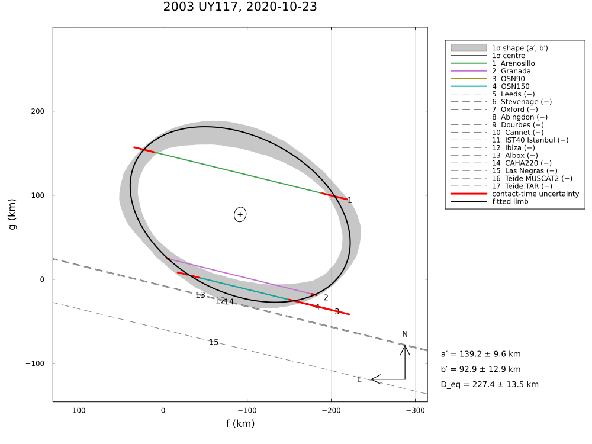

# Occultations.jl

Reduction and analysis of stellar occultations by solar-system bodies in Julia:

* **light curves** – readers (text, PyMovie, Tangra, AstroImageJ), normalisation, event detection, and a
  physical model with Fresnel diffraction (integrated over the passband), the projected
  stellar disc, the exposure time, finite opacity and the diffraction of short (grazing)
  events; fitted timings with profiled flux levels, covariance, χ² profiles or posterior;
* **atmospheres** – hydrostatic, spherically symmetric atmospheres (N₂, CH₄, CO; isothermal,
  Pluto-like inversion layer, free molecular flow) ray-traced to the refracted flux in the
  shadow (near and far limb, limb-curvature focusing, surface edge), e.g. Pluto or
  (612533) 2002 XV93 (Arimatsu et al. 2026); the surface pressure is a fit parameter;
* **limb fits** – one or several events; a 2-D ellipse (default), circle, triaxial
  **3-D ellipsoid** with pole and rotation phase (the apparent ellipse of every event follows
  from the body orientation at that epoch), or the silhouette of a **triangle mesh** (OBJ
  files, or a generated ellipsoid mesh); timed contacts with residuals measured along the
  chords, **negative chords** as hard (default) or soft constraints, partial chords, clock offsets,
  **rotational light-curve amplitudes** as constraints, Gaussian priors; or a **joint fit of
  the light curves themselves** with the limb (diffraction or atmosphere model);
* **binaries and contact binaries** – a body with a satellite or a binary system (two limb
  models, e.g. an ellipse and a circle), a contact binary as two overlapping ellipses (one
  event) or two rotating triaxial ellipsoids (several events, light-curve amplitudes); chords
  with several drops, contacts assigned to a body or matched automatically, the visible
  segments of the chords as constraints, the diffraction of narrow gaps between drops,
  astrometry of the barycentre or the photocentre;
* **ring systems** – circular rings around any body model: ring pole, radii, widths and normal
  optical depths from the timings of the ring dips or from the light curves (partly transparent
  strips with diffraction), over one or several events;
* **uncertainties everywhere** – covariance matrix, linear propagation to derived
  quantities (equivalent radius, axes, apparent ellipses, astrometric offsets), χ² profiles
  and confidence intervals, and **Bayesian posterior sampling** (affine-invariant ensemble
  sampler) with samples of all derived quantities;
* **astrometry** – the body's ICRS position from the fitted centre, including the star's
  position uncertainty;
* **geometry and predictions** – ERFA-based reduction (UTC/TT/TDB, IAU 2006/2000A Earth
  orientation, light time per observer, stellar proper motion and parallax), ground and
  space observers, MPC codes, JPL Horizons, SPICE kernels, Gaia, SBDB, Keplerian orbits,
  Besselian/CORA elements, closest approach and shadow paths on the rotating Earth;
* **plots and maps** – Plots.jl recipes (light curves, fits, chords with 1σ limb draws,
  posterior limbs, corner plots with credible regions and reference values, atmosphere
  profiles), 3-D views of shape models and of 3-D fits in the geometry of the occultation
  (`meshview`, `occview`, `occanimate`; Makie) and publication-quality maps
  with **GeoMakie** (any PROJ projection, Natural Earth coastlines, borders and capitals –
  the Julia counterpart of cartopy).

## Documentation

The manual is at **<https://mkretlow.github.io/Occultations.jl/dev/>**:

* the user guide: light curves, limb fits, binaries and contact binaries, ring systems,
  atmospheres, plots and maps, the occultation in 3-D;
* the methods: the mathematics of the limb fit, residuals along the chords or radial, the
  limb allowance σ_limb, the uncertainty bands of the plots;
* the examples, compared with the publications and with SORA;
* the validation and the API reference.

The sources of the manual are in [`docs/src/`](docs/src/); `julia --project=docs docs/make.jl`
builds it locally.

## Installation

```julia
using Pkg
Pkg.add(url="https://github.com/mkretlow/Occultations.jl")
# or, for development, a local clone:  Pkg.develop(path="/path/to/Occultations.jl")
```

GeoMakie (maps) and Makie are dependencies. Optional: `Plots` (recipes), a Makie backend to
display or save maps (`CairoMakie` for files, `GLMakie` for interactive windows), `HTTP`
(Horizons, Gaia, SBDB, MPC), `SPICE` (kernels).

## Quick start

```julia
using Occultations, Plots

# star, body (ephemeris from Horizons with `using HTTP`, or a table / orbit / SPICE kernel)
star = Star("16 04 37.609", "-16 51 19.78"; pmra=-3.1, pmdec=-5.0, parallax=0.4, mag=Dict("V"=>14.0, "K"=>12.5))
body = Body("2002 XV93", horizons_ephem("612533", "2024-01-10T14:00", "2024-01-10T16:00"); radius=250.0, density=1500.0)
ev   = Event(star, body, "2024-01-10T15:00")              # closest approach searched around this time

# a light curve → timings with the diffraction model → a chord
lc  = read_lightcurve("kiso.csv"; format=:pymovie, exptime=0.5, λ=0.6, Δλ=0.3)
obs = Observer("Kiso", "137 37 31", "35 47 50", 1130)
v   = shadow_velocity(star, body, ev.tref; observer=obs)  # (better: the velocity normal to the limb)
tf  = fit_timing(normalize(lc); vel=v, dist=ev.ca.dist_km, star_diam=apparent_diameter(star, ev.ca.dist_km))
plot(tf)
push!(ev, Chord("Kiso", obs, tf))

# published timings, negative and partial chords
push!(ev, Chord("Kyoto", Observer("Kyoto", 135.78, 35.03, 60); immersion="2024-01-10T15:00:01.2",
                emersion="2024-01-10T15:00:19.2", immersion_err=0.5, emersion_err=0.5))
push!(ev, Chord("Fukushima", Observer("Fukushima", 140.47, 37.75, 70);
                span=("2024-01-10T14:59:30", "2024-01-10T15:01:00"), sensitivity=0.5))

# limb fit (2-D ellipse; negative chords as hard constraints) with a fitted clock offset
r = fit_limb(ev; fit_dt=["Kyoto"])
r[:equatorial_radius], r[:equivalent_radius]             # (value, σ)
astrometry(r)                                             # RA/Dec of the body, offsets, errors incl. the star
plot(r)                                                   # chords, fitted limb, 1σ limb draws
post = sample(r; nsteps=3000)                             # Bayesian posterior
summarize(post); derived_summary(post)
cornerplot(post; vars=[:equatorial_radius, :oblateness], axislabels=Dict(:equatorial_radius => "a [km]"),
           truths=Dict(:equatorial_radius => 250.0), truth_label="published")
confidence_interval(r, :oblateness)                       # from the χ² profile

# a published ellipse (or a shape-model limb) against the negative chords
check_negative_chords(ev, ellipse_outline(; equatorial_radius=260.0); center=(r[:center_f][1], r[:center_g][1]))

# maps
import CairoMakie                                         # backend for saving Makie figures
CairoMakie.save("map.png", geomap(r; window=600, projection="+proj=laea +lon_0=138 +lat_0=36",
                                  limits=(120, 155, 25, 45)))  # borders, capitals, numbered stations
geomap(r; observer_labels=:name, resolution=10)          # names on the map, 1:10m Natural Earth

# shape models
using GLMakie                                             # or CairoMakie for images
meshview(read_obj("shape.obj"))                           # body frame, rotate with the mouse
meshview(body, ev.tref)                                   # as seen from the Earth, with the limb
```

## Examples

The tutorial and the synthetic examples simulate occultations with a known truth; the others
reduce a published occultation again, from the data given in the paper. Each example writes its
figures and printed results to `examples/output/<example>/`:

| Example | Event | Publication | Shows |
|---|---|---|---|
| [`quickstart.ipynb`](examples/quickstart.ipynb) | Varda 2018 | Souami et al. 2020 | Jupyter notebook: prediction, chords, limb fit, astrometry, posterior, maps |
| [`tutorial.jl`](examples/tutorial.jl) | synthetic | – | all features, offline |
| [`sim_binary.jl`](examples/sim_binary.jl) | synthetic | – | a satellite (circle or ellipse), a binary of similar bodies, barycentre, coverage |
| [`sim_contact_binary.jl`](examples/sim_contact_binary.jl) | synthetic | – | a contact binary: light curves with two drops, joint light-curve fit |
| [`sim_contact_binary_3d.jl`](examples/sim_contact_binary_3d.jl) | synthetic, 4 events | – | a contact binary in 3-D: two rotating ellipsoids, unknown pole |
| [`sim_rings.jl`](examples/sim_rings.jl) | synthetic | – | two narrow rings: ring dips in light curves, widths and optical depths |
| [`sim_ring_pole.jl`](examples/sim_ring_pole.jl) | synthetic, 3 events | – | a distant ring: the ring pole from several events |
| [`huya_2019.jl`](examples/huya_2019.jl) | (38628) Huya, 2019-03-18 | Santos-Sanz et al. 2022 | σ_limb, clock priors, posterior |
| [`2002kx14_2020_2023.jl`](examples/2002kx14_2020_2023.jl) | (119951) 2002 KX14, 5 events | Rizos et al. 2025 | multi-event fit, mirror solution, albedo |
| [`2003uy117_2020.jl`](examples/2003uy117_2020.jl) | (143707) 2003 UY117, 2020-10-23 | Kretlow et al. 2024 | 13 negative chords, 3-D ellipsoid with light-curve amplitude and phase |
| [`2002xv93_2024.jl`](examples/2002xv93_2024.jl) | (612533) 2002 XV93, 2024-01-10 | Arimatsu et al. 2026 | light-curve fits, atmosphere detection |
| [`1995sm55_2024.jl`](examples/1995sm55_2024.jl) | (24835) 1995 SM55, 2024-02-25 | Ortiz et al. 2025 | albedo, 3-D ellipsoid, inconsistent timings |
| [`huya_2023.jl`](examples/huya_2023.jl) | (38628) Huya, 2023-06-24 | Rommel et al. 2025 | negative chords, satellite |
| [`huya_2023_satellite.jl`](examples/huya_2023_satellite.jl) | (38628) Huya, 2023-06-24 | Rommel et al. 2025 | Huya and its satellite fitted together (`BinaryLimb`) |
| [`ixion_2020_2023.jl`](examples/ixion_2020_2023.jl) | (28978) Ixion, 6 events | Kilic et al. 2026 | global fit, astrometry |
| [`2007uk126_2014.jl`](examples/2007uk126_2014.jl) | (229762) 2007 UK126, 2014-11-15 | Schindler et al. 2017 | three chords, non-Gaussian posterior |
| [`varda_2018.jl`](examples/varda_2018.jl) | (174567) Varda, 2018-09-10 | Souami et al. 2020 | limb and astrometry |
| [`2002tc302_2018.jl`](examples/2002tc302_2018.jl) | 2002 TC302, 2018-01-28 | Ortiz et al. 2020 | σ_limb, clock offsets, star position |
| [`2003az84_2012_2014.jl`](examples/2003az84_2012_2014.jl) | (208996) 2003 AZ84, 2011–2014 | Dias-Oliveira et al. 2017 | three chords per event, single-chord events, astrometry |
| [`2003vs2_2019.jl`](examples/2003vs2_2019.jl) | (84922) 2003 VS2, 2019-10-22 | Vara-Lubiano et al. 2022 | clock offset of a chord, 3-D ellipsoid |
| [`haumea_2017.jl`](examples/haumea_2017.jl) | (136108) Haumea, 2017-01-21 | Ortiz et al. 2017 | the ring from mid-times, 3-D shape |
| [`2002gz32_2017.jl`](examples/2002gz32_2017.jl) | (95626) 2002 GZ32, 2017-05-20 | Santos-Sanz et al. 2021 | an elongated centaur |
| [`makemake_2011.jl`](examples/makemake_2011.jl) | (136472) Makemake, 2011-04-23 | Ortiz et al. 2012 | circle and ellipse, star from Gaia |
| [`chariklo_2017_2020.jl`](examples/chariklo_2017_2020.jl) | (10199) Chariklo, 7 events 2017–2020 | Morgado et al. 2021 | two rings, mirror pole, astrometry |
| [`2002ms4_2020.jl`](examples/2002ms4_2020.jl) | (307261) 2002 MS4, 2020-08-08 | Rommel et al. 2023 | 59 chords, global ellipse, topography |
| [`quaoar_2011_2022.jl`](examples/quaoar_2011_2022.jl) | (50000) Quaoar, 2011 and 2022 | Braga-Ribas et al. 2013, Pereira et al. 2023 | limb, two rings |
| [`chiron_2018_2019.jl`](examples/chiron_2018_2019.jl) | (2060) Chiron, 2018 and 2019 | Braga-Ribas et al. 2023 | few chords, clock offset |
| [`2007oc10_2022.jl`](examples/2007oc10_2022.jl) | (470316) 2007 OC10, 2022 | Gómez-Limón et al. 2025 | a double star: light curves fitted directly, posterior |
| [`bienor_2019_2023.jl`](examples/bienor_2019_2023.jl) | (54598) Bienor, 4 events 2019–2023 | Fernández-Valenzuela et al. 2023, Rizos et al. 2024 | clock offsets, binary alternative, 3-D ellipsoid |



The results are compared with the publications in the manual
([Examples](https://mkretlow.github.io/Occultations.jl/dev/examples/), [Comparison with published reductions](https://mkretlow.github.io/Occultations.jl/dev/comparison/publications/)).

## Licence and citation

Occultations.jl is released under the [MIT licence](LICENSE). If you use it, please cite it
as given in [`CITATION.cff`](CITATION.cff). Changes are listed in
[`CHANGELOG.md`](CHANGELOG.md).

## Data and licences

The papers whose data are used in the examples are listed, with their DOIs, in
[`references/`](references/README.md).


The maps use Natural Earth data (public domain) through GeoMakie.
